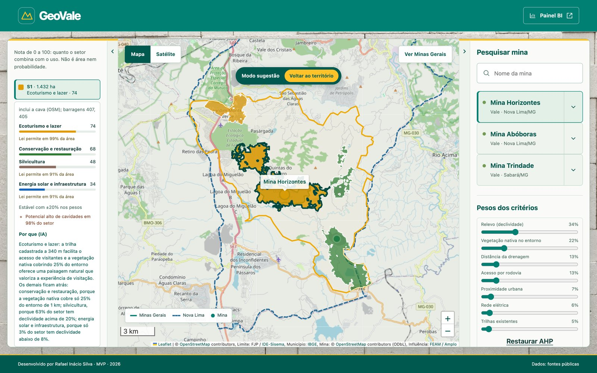

# GeoVale · IA para o pós-mineração

**Sistema de apoio à decisão** que junta geoprocessamento, análise multicritério e **IA generativa com guarda-corpos** para sugerir e explicar usos futuros de áreas mineradas. O engenheiro escolhe a mina, o sistema ordena os usos possíveis em cada setor da área minerada e a IA explica, pelo terreno, por que cada uso ficou em 1º.

**[Abrir o GeoVale no ar](https://geo-vale.vercel.app)** · [Painel BI](https://lookerstudio.google.com/reporting/3dca8a93-d660-4d28-9f93-e3a3e53ff813/page/BCbCG) · `Python` · `FastAPI` · `React` · `TypeScript` · `OpenAI` · `Geoprocessamento` · `AHP`



*Mina Horizontes (Nova Lima/MG) no modo **Sugerir uso**: cada setor da área minerada aparece pelo uso que ficou em 1º; à esquerda, o ranking do setor S1 e a explicação gerada pela IA; à direita, os pesos dos critérios, que o engenheiro pode mudar.*

## Onde está a IA

| Peça | O que faz | Como é controlada |
|---|---|---|
| **Explicação da sugestão** · "Por que (IA)" | Escreve por que o 1º uso combina com cada setor (trilhas, vegetação, declividade…), na tela e no PDF | Recebe só fatos já calculados do setor; a frase sobre os demais usos fica por regras |
| **Leitura contextual do relatório** | Interpreta cada dado das sete fichas temáticas (água, solos, barragens, conservação…) | Um guia por tema ensina o modelo a ler Q7,10, APP, ZAS, grupos de UC e barragens a montante |
| **Guarda-corpos** | Impede que um texto plausível, mas errado, chegue ao engenheiro | Structured Outputs com JSON Schema estrito; **número que não foi enviado ao modelo é recusado**; recusa, erro ou truncamento voltam ao texto por regras; “(IA)” aparece só quando o texto veio do modelo |
| **Privacidade e custo** | Mantém o dado e a chave sob controle | Só texto calculado sai do servidor (sem geometrias), `store=false`, temperatura 0,2, cache das respostas; a chave nunca vai ao navegador |

**A IA explica, não decide.** O ranking vem de um método auditável: restrições legais excluem usos (SNUC, Código Florestal, ZAS de barragens), sete critérios ponderados por **AHP** (razão de consistência 0,012) somam a nota de cada uso e um teste de **sensibilidade ±20%** marca os setores em que a ordem é frágil. O modelo de linguagem (`gpt-4.1-mini`, Responses API) só transforma esse resultado em uma explicação legível. [Método completo](docs/MULTICRITERIO.md).

## Como funciona

```
18 bases públicas ─► recorte da mina ─► setores da área ─► restrições ─► 7 critérios ─► ranking + ─► IA explica ─► mapa, PDF
(WFS, WCS, ArcGIS)   e área minerada    minerada ≥ 20 ha    legais        pesos AHP      sensibilidade  (com conferência)   e Painel BI
```

1. **Conhecer.** Selecionar a mina mostra o contorno. **Influência** recorta sete temas e dezoito bases (relevo, água, solos, vegetação, infraestrutura, barragens, trilhas) no território da mina. **Ver relatório** gera um PDF com sete mapas temáticos, dados separados entre área minerada e entorno e a leitura de cada dado.
2. **Conceber.** **Sugerir uso** divide a área minerada em setores, aplica as restrições legais e ordena quatro usos: conservação e restauração, ecoturismo e lazer, silvicultura, energia solar e infraestrutura. O engenheiro move os pesos, o mapa recalcula e o relatório ganha a ficha da sugestão com esses pesos.
3. **Explicar.** Para cada setor, a IA escreve o porquê do 1º lugar; o texto passa pela conferência antes de aparecer.

Os dados são consultados automaticamente e guardados por mina em SQLite, com fontes, datas e metadados. Três minas da Vale estão no catálogo: **Horizontes** e **Abóboras** (Nova Lima/MG) e **Trindade** (Sabará/MG) ([Catálogo de minas](docs/MINAS.md)). O **Painel BI** no cabeçalho abre a visão geral das três minas no Looker Studio ([conteúdo do BI](docs/BI.md)).

## Executar

Python **3.12**, Node **24**. Na raiz:

```bash
python3.12 -m venv .venv-geovale
source .venv-geovale/bin/activate
python -m pip install --require-hashes -r requirements/compatibilidade-macos15-x86_64.txt
cd frontend
npm ci
npm run build
cd ..
python executar.py
```

Abra **http://127.0.0.1:8000**. O servidor escuta somente em loopback. Outra porta: `GEOVALE_PORT=8020 python executar.py`. O comando não abre o navegador. O lock Linux é separado; execução Linux não foi conferida. Em desenvolvimento, Vite na porta 5173 encaminha `/api` para a porta 8000.

Internet é necessária para preparar/atualizar dados, fundos e serviços visuais. Reiniciar o servidor conserva os dados já guardados, sem baixar novamente bases ainda válidas. Imagens do mapa continuam dependendo de seus fornecedores.

## Verificar

```bash
PYTHONPATH=backend PYTHONDONTWRITEBYTECODE=1 PYTEST_DISABLE_PLUGIN_AUTOLOAD=1 python -m pytest -q -p no:cacheprovider tests
cd frontend
npm test
npm run build
```

## Organização

- `backend/geovale/api/main.py`: API local, ciclo de preparação e interface compilada.
- `backend/geovale/camadas.py`: catálogo único de visualização e processamento, com dezoito bases.
- `backend/geovale/fontes_territorio.py`: adaptadores WFS/WCS/ArcGIS, atributos completos, interseção e células.
- `backend/geovale/territorio.py`: preparação automática e persistência por mina/base.
- `backend/geovale/relatorio.py`: PDF e prévia versionada em PNG.
- `backend/geovale/mapa_relatorio.py` e `fichas.py`: mapas temáticos, área minerada, medidas em UTM 23S e checagem dos pontos de água simulados.
- `backend/geovale/multicriterio.py`: setores da área minerada, restrições legais, AHP, soma ponderada e sensibilidade.
- `backend/geovale/comentarios.py`: leitura contextual das fichas (com guia por tema) e explicação da sugestão por OpenAI Responses / GPT-4.1 mini, com regras de reserva.
- `dados/cenarios/horizontes.json`: pontos e valores técnicos fictícios, métodos hipotéticos e referências.
- `backend/geovale/influencia.py`: conferência do recorte local e evidências.
- `backend/geovale/mapa.py`, `municipio.py`, `anm.py`, `trilhas.py`: navegação, município, cadastro e trilhas visuais.
- `frontend/src/Influencia.tsx` e `CamadasNaInfluencia.tsx`: botões, camadas recortadas e relatório PDF da mina.
- `frontend/src/SugestaoNoMapa.tsx`, `PainelSugestao.tsx` e `useSugestao.ts`: modo sugestão, setores no mapa, painel e pesos.
- `dados/minas.json`: catálogo da mina e identificação.
- `dados/influencias`: influência aproximada, snapshot OSM e receita de preparo.
- `ferramentas/preparar_influencia.py`: reprodução local do contorno e sombreado.
- `.local/territorios.sqlite3`: dados gerados localmente; ignorados pelo Git.
- `docs`: [índice da documentação atual](docs/INDICE.md).

## Decisões e limites

O único recorte de caracterização do MVP vem do **contorno externo AII de águas e solos**, Figura 2.3 do parecer FEAM sobre ampliação conjunta Tamanduá/Horizontes. Usá-lo para todos os temas é uma **simplificação declarada do protótipo**, não delimitação temática oficial ou área obrigatória de recuperação. A mina sombreada vem do OpenStreetMap, representa só a cava e não certifica perímetro físico atual. A **área minerada** usada nas fichas é a classe Mineração do MapBiomas dentro do recorte (3.173,3 ha); a AII é contexto.

Dados geográficos guardados são resultados calculados das fontes. Um cenário técnico fictício de pós-fechamento, identificado em seção própria, complementa o relatório para demonstrar informações que as camadas não fornecem; seus pontos de água são conferidos com a classe real do trecho e os limites da CONAMA 357/2005. As premissas não alteram os dados reais. A atualização automática ocorre a cada 24 horas enquanto o servidor está ligado; falhas têm novas tentativas, mantendo data/estado explícitos. Uma fonte indisponível não vira quantidade zero. Adicionar uma base requer sua configuração no catálogo e adaptador compatível; não existe descoberta automática de todo serviço da internet.

A sugestão multicritério ordena usos por setor para discussão: restrições legais excluem usos, sete critérios somam com pesos AHP ou do engenheiro e a sensibilidade mostra quando a ordem é frágil. Não é aptidão legal, decisão, definição de beneficiários, diagnóstico de impactos ou de qualidade ambiental. O relevo é regional e antigo; contagens são registros, não riscos ou rios distintos. Acesso público não significa uso ilimitado. O cenário não constitui laudo ou avaliação de segurança. O 3D Google não está integrado.

[Justificativa e roteiro para apresentação](docs/ESCOLHAS_TERRITORIAIS.md), [multicritério e IA](docs/MULTICRITERIO.md), [recorte e evidência](docs/INFLUENCIA.md), [dados automáticos](docs/DADOS_TERRITORIAIS.md), [uso](docs/MANUAL_USO.md), [relatório e cenário](docs/RELATORIO.md).

Os fatos são separados da leitura contextual por dado. A IA generativa escreve essa leitura e explica a sugestão, com números conferidos; sem chave ou com resposta recusada, entra o texto por regras, sem a marca “(IA)”. Não há ML treinado. [Configuração e método](docs/RELATORIO.md).
