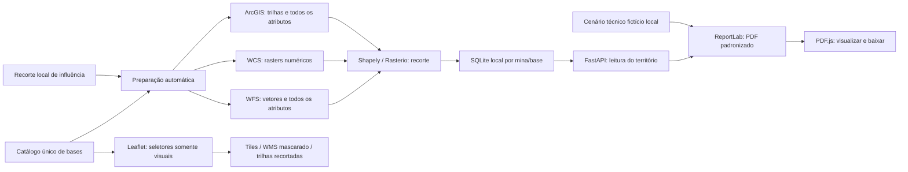

# Arquitetura — território preparado por mina

`executar.py` serve interface compilada/API em `127.0.0.1:8000`. Configuração e limite estadual são lidos em paralelo. Selecionar mina consulta ANM, município, contorno e resumo guardado sem acoplá-los: falha de uma fonte não interrompe as outras.

## Contratos

| Método e rota | Resposta |
|---|---|
| GET /api/saude | Saúde e versão 4.1.0 |
| GET /api/mapa | Uma mina, fundos e catálogo de seis temas/onze bases |
| GET /api/mapa/limite-mg | Contorno estadual, fonte/data e aviso de cache quando aplicável |
| GET /api/mapa/trilhas?bbox=... | Trilhas visuais e legenda do enquadramento; 422/503 |
| GET /api/minas/{id}/processo-anm | Atributos cadastrais e fonte, sem geometria; 404/503 |
| GET /api/minas/{id}/limite-municipal | Somente município associado; 404/503 |
| GET /api/minas/{id}/relatorio | PDF GeoVale inline; ?baixar=true entrega attachment; 404/503 |
| GET /api/minas/{id}/trilhas-influencia | Trilhas visuais geometricamente recortadas e legenda; 404/503 |
| GET /api/minas/{id}/influencia | Duas Features: influência comum e mina sombreada; 404/503 |
| GET /api/minas/{id}/territorio | Estado/resumo de todas as bases persistidas, independente de visibilidade; 404/503 |
| GET /api/minas/{id}/territorio/{base_id} | Todos os registros/atributos ou metadados matriciais guardados; 404/503 |
| GET /api/minas/{id}/territorio/{base_id}/arquivo | GeoTIFF mascarado já preparado; 404/503 |
| GET / e /assets/... | Interface compilada; raiz retorna 503 se o build faltar |

Rotas desconhecidas retornam 404. O cliente não fornece URL, camada ou polígono arbitrário. IDs de base são derivados da camada do catálogo. Leitura do território não provoca consulta externa. Respostas locais usam no-store; datas são as de preparação da fonte guardada, não o momento de abrir o painel.

## Preparação e armazenamento

`DadosTerritoriais` começa no lifespan FastAPI em uma thread de agendamento, independente dos clientes. Percorre as minas/recortes locais e todas as bases derivadas de CAMADAS. A cada minuto confere bases novas, alteradas, vencidas em 24 h ou falhas com espera de cinco minutos. Usa ThreadPoolExecutor com até três bases simultâneas. Encerrar o servidor para agendamento; resultados completos já gravados permanecem.

`fontes_territorio.py` implementa adaptadores WFS/WCS/ArcGIS. Vetores são validados por esquema/contagem/CRS/IDs e intersectados em Shapely; rasters são lidos/mascarados em Rasterio mantendo grade/valores nativos. Fontes fixas do catálogo, leitura até 32 MiB/25 s por requisição, 2.000 registros/base e 4 milhões de células/raster. [Método completo](DADOS_TERRITORIAIS.md).

SQLite em `.local/territorios.sqlite3`, WAL, uma linha por mina/camada, JSON comprimido e GeoTIFF BLOB. Assinatura inclui definição da base, influência/evidência e versão do método. Gravação da base completa é atômica; falha conserva estado/última resposta válida da mesma assinatura. Mudança do recorte não exibe dados antigos incompatíveis. Arquivos gerados são ignorados pelo Git.

## Interface e mapa

`Influencia.tsx` lê contorno e território ao selecionar. Atualiza o resumo local a cada três segundos enquanto incompleto e a cada minuto quando completo; na falha de leitura, tenta após 15 s. Esses pedidos leem SQLite. Cancela leituras ao trocar/desmarcar mina. O estado completo habilita Ver relatório sem exigir Influência. RelatorioDaMina.tsx abre diálogo e busca o PDF; PreviaPDF.tsx carrega PDF.js/worker no build oficial legacy sob demanda, adapta o canvas à largura, fornece texto acessível e navegação. Baixar PDF usa o mesmo Blob exibido. Erro de renderização tem Tentar novamente, com reinicialização do leitor e liberação do worker anterior; mensagens não desmontam o canvas necessário à recuperação. Fontes e detalhes ficam no arquivo/documentação, sem painel na tela.

Selecionar pelo cartão ou pela bolinha mostra o contorno da mina, independentemente de Influência. O botão Influência mostra/esconde somente o contorno externo e camadas recortadas e enquadra o recorte por ação explícita, interrompendo transições anteriores. Mina sombreada e influência ficam em pane 430, sem interceptar cliques. O município, pane 420, não altera o enquadramento depois de uma interação da influência ou navegação. Marcador sempre aproxima em zoom 14. Dados persistidos não dependem do estado visual.

Com Influência ativa, `CamadasNaInfluencia.tsx` mostra os cinco temas WMS mascarados no navegador pelo polígono irregular, mais trilhas intersectadas no backend. A máscara `clip-path` acompanha coordenadas da camada, zoom/redimensionamento; imagens recortadas ocultam durante animação de zoom. Marcar um tema substitui sua versão recortada pela versão expandida de `MapaTerritorio.tsx`; desmarcar restaura o recorte. Sem Influência os seletores mostram/retiram a versão normal. Ordem, timeout, intensidade e legendas permanecem. Imagens atuais do fornecedor são independentes da data do relatório persistido. Trilhas visuais usam a configuração oficial de cores/nomes, consulta leve por bbox e cache de dez minutos/16 enquadramentos. Contorno estadual tem cache de uma hora, simplificação visual e aviso no reaproveitamento vencido; ANM, dez minutos; município, uma hora. Esses caches de navegação são separados do armazenamento territorial.

As barras ocultam sem desmontar o painel; ResizeObserver atualiza o tamanho Leaflet. Desktop mantém rolagem nas laterais; celular dispõe território, mapa e consulta em sequência. Créditos acompanham as camadas. Um ResizeObserver mede a atribuição Leaflet e atualiza a variável CSS --altura-creditos; legenda territorial e escala ficam acima dela com espaçamento, mesmo com várias linhas. Sem autenticação/implantação pública, ranking ou serviços de IA.

## Documento e cenário

`relatorio.py` recebe o catálogo completo persistido e lê o cenário da mina. Gera mapas vetoriais em EPSG:31983 somente para apresentação, sem alterar as geometrias armazenadas. ReportLab incorpora fontes Unicode e desenha nossa marca. PDF com seções, marcadores de navegação, tabelas que repetem cabeçalho e anexo com todos os registros. As matrizes continuam em GeoTIFF interno e aparecem como classes/contagens no PDF.

Um cache por mina usa assinatura dos dados, cenário e versão do modelo. Consultar não refaz chamadas externas. Alterar cenário, consulta válida ou modelo invalida o PDF. `baixar=true` muda apenas Content-Disposition. O cenário identifica premissas fictícias inspiradas metodologicamente no plano Minas-Rio; a versão dos adaptadores de coleta permanece 4.0.0, pois não houve alteração de cálculos ou recorte. API/interface/documento estão na versão 4.1.0.
