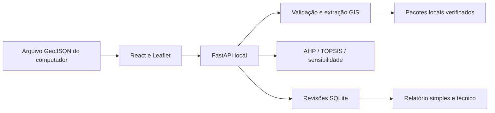

# Arquitetura implementada

React + TypeScript + Leaflet na interface. Python/FastAPI na API. Shapely/PyProj/Rasterio/NumPy para geografia e cálculo; Matplotlib e Jinja2 para HTML autossuficiente; SQLite para revisões.

`executar.py` serve o build `frontend/dist` e `/api` em uma origem, escutando em 127.0.0.1. Em desenvolvimento, Vite 5173 faz proxy para API 8000. Não há servidor de modelos ou chamadas de IA. A implantação Vercel/Railway anteriormente planejada não é a arquitetura operacional desta entrega local; poderá ser retomada com acesso, persistência e contrato de sessão adequados.

## Responsabilidades

- `geografia/entrada.py`: validação robusta, multipart limitado em `mvp/entrada_http.py`.
- `decisao/territorio.py`: contorno, reconhecimento geométrico, fontes fixas, qualidade de cobertura, métricas e matriz exploratória.
- `decisao/metodos.py`: AHP, TOPSIS e sensibilidade sem dependência HTTP ou banco.
- `mvp/servico.py`: estados, invalidação, versão aceita e resumo público.
- `mvp/api.py`: sessão, contratos HTTP, concorrência, persistência e exportação.
- `mvp/armazenamento.py`: revisão JSON imutável e assinatura SHA256.
- `mvp/relatorios.py`: dois documentos da revisão salva; imagem e fontes locais.

## Contratos

| Rota | Operação |
|---|---|
| GET `/api/areas/{id}/imagem` | Foto de referência após upload, somente na sessão proprietária |
| POST `/api/areas` | Multipart com um arquivo no campo `arquivo` |
| GET `/api/areas/{id}` | Estado da própria sessão |
| POST `/api/areas/{id}/analisar` | `{versao}`; extrai métricas |
| POST `.../prioridades` | `{versao, comparacoes:[a,b,c]}`; AHP |
| POST `.../comparar` | `{versao,pesos:[...],origem:'ahp' ou 'manual'}` |
| POST `.../salvar` | `{versao}`; revisão imutável/idempotente |
| GET `.../revisoes/{n}/simples` ou `/tecnico` | HTML da revisão e da sessão |
| GET `/api/saude` | Estado e método ativo |

Mutações exigem `X-GeoVale: 1`; origem aceita é a origem local do servidor ou a origem de desenvolvimento explicitada. Host restrito a localhost/127.0.0.1/testserver. Cookie anônimo aleatório HttpOnly, SameSite Strict, um dia; sem senha no frontend. `Secure=False` exclusivamente porque a demonstração usa HTTP local. Não é autenticação corporativa.

Rascunhos ficam em memória e podem expirar após duas horas (limpeza na entrada de nova área); limites de 20 por sessão/100 totais. Extração raster ocorre fora do loop assíncrono; checa-se a versão antes e depois. Reiniciar o servidor perde rascunhos; revisões salvas sobrevivem e suas URLs funcionam enquanto o mesmo cookie existir. Não há tela de recuperação de histórico nesta versão.

O frontend recebe mapa, resumo territorial, pesos e ranking resumido. Não recebe matrizes completas, hashes ou configurações internas. Trocar pesos esconde o resultado anterior até recalcular; cada mutação aceita incrementa a versão e invalida o resultado dependente. Erros não substituem a última análise válida.

A entrada de áreas exige um arquivo enviado pelo usuário. A imagem de fundo é vinculada à área e à sessão proprietária. Os pacotes geográficos locais permanecem como fontes internas da análise e dos relatórios.
