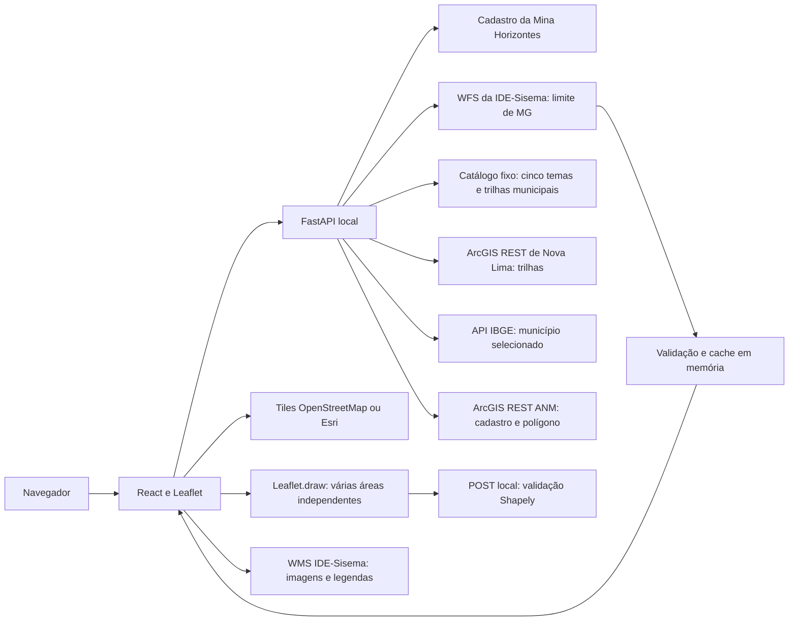

# Arquitetura — mapa territorial

`executar.py` serve o build frontend e a API na mesma origem, em `127.0.0.1:8000`. O frontend inicia duas consultas independentes em paralelo: configuração do mapa e contorno. O mapa de fundo e a pesquisa podem abrir enquanto o limite carrega. No desenvolvimento, Vite encaminha `/api` para o backend local.

## Contratos

| Método e rota | Resposta |
|---|---|
| `GET /api/saude` | Disponibilidade do aplicativo e versão |
| `GET /api/mapa` | Enquadramento inicial, uma mina, fundos e catálogo de seis opções com suas bases, tipos, coberturas e legendas |
| `GET /api/mapa/limite-mg` | FeatureCollection estadual simplificada, origem, data da consulta e aviso quando aplicável |
| `GET /api/mapa/trilhas?bbox=...` | Traçados municipais no enquadramento visível; 422 para bbox inválida e 503 na falha externa |
| `GET /api/minas/{mina_id}/processo-anm` | Feature cadastral ANM e fonte/data; 404 para mina desconhecida e 503 na falha externa |
| `GET /api/minas/{mina_id}/limite-municipal` | FeatureCollection IBGE do município selecionado; 404 para mina desconhecida e 503 na falha externa |
| `POST /api/area/validar` | Valida e devolve a Feature poligonal; 422 para desenho inválido e 413 acima de 128 KiB |
| `GET /` | Interface compilada; 503 com orientação se o build estiver ausente |
| `GET /assets/...` | Recursos do build |

Rotas desconhecidas retornam 404. As fontes são consultadas em leitura; a rota POST apenas valida a geometria enviada à API local, sem armazená-la ou transmiti-la a terceiros. Não há persistência em banco.

## Consulta externa

O backend chama `GetFeature` WFS 2.0.0, com camada fixa `IDE:ide_1101_mg_unidade_federacao_pol`, no máximo uma feição e saída GeoJSON em EPSG:4326. Não recebe URL ou nome de camada arbitrário do navegador. A leitura limita a resposta a 6 MiB, com timeout de 15 segundos. Confere o código de UF 31, referência espacial, tipo/validade geométrica e extensão esperada de MG.

O dado oficial consultado contém uma autointerseção de anel. Para a representação visual, Shapely aplica `make_valid` quando necessário, conserva os componentes poligonais e simplifica em 0,001 grau com preservação de topologia. A resposta registra `ajuste_topologico_visual`; esse tratamento não é medição nem alteração de cadastro oficial. O último contorno válido permanece em memória por uma hora. Uma trava evita downloads simultâneos duplicados. Não há tarefa periódica: após a validade, uma nova requisição pode renovar o cache. A memória é descartada quando o processo termina.

Falha na primeira consulta retorna 503. Falha de renovação conserva a última resposta válida e a data original, com aviso. Mensagens internas do fornecedor não são enviadas ao usuário. As duas leituras iniciais são compartilhadas pelo frontend durante a montagem dupla de desenvolvimento do React.

O navegador solicita tiles apenas da região e zoom visíveis. O botão Mapa/Satélite troca o provedor. Não há aquisição em lote nem armazenamento offline dos tiles. O contorno e o marcador permanecem quando uma imagem falha. Erros do fundo têm controle de recarga.

O componente Leaflet é desmontado corretamente; o redimensionamento apenas invalida seu tamanho, preservando a navegação do usuário. A chegada tardia do contorno não desfaz uma mina já selecionada. A seleção registra a origem da ação: cartão ou marcador. O cartão alterna seleção e permite enquadramento municipal; o marcador sempre aproxima a mina em zoom 14 e bloqueia o reenquadramento municipal, inclusive para resposta pendente. Os dados municipais dependem de id/coordenadas, sem nova consulta ao repetir o clique no marcador. A resposta também preserva a câmera se o engenheiro já navegou ou começou uma área. Desmarcar pelo cartão enquadra novamente MG. O marcador tem papel de botão, rótulo acessível e ações Enter/Espaço. “Ver Minas Gerais” enquadra o estado, remove município e seleção, mantendo áreas e temas.

## Sobreposições WMS

`backend/geovale/camadas.py` define cinco temas compostos por dez bases. `/api/mapa` entrega o catálogo fixo com identificadores, URL WMS, intensidade inicial, ordem de desenho, atribuição e links oficiais de legenda/metadado. Não consulta o catálogo inteiro em cada abertura, não recebe URL arbitrária e não adiciona proxy de mapas. Esta etapa não usa credenciais Google nem uma API 3D.

`App` mantém o estado de temas ativos, intensidade e recuperação. `CamadasTerritorio` apresenta checkboxes, controles condicionais e legendas. `MapaTerritorio` mantém uma instância WMS por tema ativo, com seus componentes unidos numa requisição `GetMap` (camadas em ordem no parâmetro `layers`). Leaflet solicita PNG transparente em WMS 1.1.1, EPSG:3857, blocos de 512 pixels, `noWrap`, sem buffer e sem atualizar a cada quadro do zoom. Não há download do conjunto estadual bruto.

Faixa de solicitação: envelope regional entre latitudes −23,5 e −14 e longitudes −51,3 e −38,7. Esse envelope limita tráfego; não recorta nem certifica o limite estadual ou impede pequenas bordas das fontes. Fora dele, o controle informa que o tema está disponível em MG. Não há camada temática global.

Ordem fixa, de baixo para cima: vegetação/conservação, solos, declividade, água, entorno. Bases de um mesmo tema seguem a ordem do catálogo. Todas ficam abaixo do contorno e marcador. Intensidade altera `setOpacity`, sem recriar a instância. Marcar outro tema não remove os anteriores; desmarcar cancela eventos/timer e retira apenas aquele tema/crédito. Mudar fundo e navegar não altera a seleção dos temas.

Eventos `loading`, `tileerror` e `load` alimentam estado público; espera de 25 segundos também informa falha. A recarga redesenha só o tema correspondente. Erro parcial não é interpretado como ausência de dados. Legendagem usa `GetLegendGraphic` por base apenas ao abrir o detalhe, com nome e recuperação para imagem indisponível. Desmontar limpa instâncias, observadores, eventos e timers. Créditos dos temas são adicionados e removidos com a sobreposição.

## Trilhas municipais

`TrilhasNoMapa` cria uma camada vetorial com cores oficiais por `Name`, tooltip com nome em `textContent` e crédito da Prefeitura. Ao ativar e após `moveend`, consulta `/api/mapa/trilhas` com bbox visível em EPSG:4326. O movimento cancela a consulta anterior e espera 250 ms; timeout de 20 s. Fora do envelope municipal não consulta a fonte. Intensidade altera apenas a opacidade, preservando a cor de cada feição e sem refazer a consulta. Desativar limpa camadas, eventos, timer, pedido e crédito. A pane fica abaixo do contorno e da área manual, acima das imagens WMS.

O backend usa somente a URL ArcGIS REST fixa, recorta a bbox à extensão publicada, solicita `OBJECTID,Name`, geometria e `outSR=4326`. Timeout de 15 s, leitura de até 6 MiB e limite de 2.000 registros; resposta truncada é falha, não sucesso parcial. Confere FeatureCollection, linhas válidas e extensão. Expõe nome, identificador e símbolo sanitizado (cor RGB hexadecimal, alpha e largura em pixels), além da legenda filtrada; não repassa mensagens internas. Cache com trava, TTL de 600 s e até 16 enquadramentos, sem arquivos/banco. A simbologia do item oficial é compartilhada por 600 s; na primeira leitura ou expiração, geometria e configuração são consultadas em paralelo. A configuração tem timeout de 15 s e limite de 1 MiB. Falha de renovação retorna 503, sem reaproveitar resposta vencida. Documentação da fonte em [Trilhas](TRILHAS_NOVA_LIMA.md).

## Áreas de estudo

`AreaEstudo` usa Leaflet.draw sem sua barra padrão. Os controles React seguem a identidade da interface. Estados: vazio, desenho, ajuste, validação, carregamento ANM, prévia ANM e confirmado. Um Map de áreas numeradas mantém as Features confirmadas na memória da página. Um FeatureGroup recebe o recorte ativo/rascunho; outro mantém as demais áreas, selecionáveis por clique. A lista React permite seleção por teclado. Adicionar preserva o conjunto; ajustar/redesenhar/remover afetam só o id selecionado. Cancelar retorna ao id anterior e restaura sua confirmação. A numeração não é reutilizada durante a sessão. Requests pendentes são cancelados na saída ou cancelamento. Desmontar remove handlers, eventos e grupo.

A confirmação envia a Feature para `/api/area/validar`; Shapely rejeita autointerseção, anel aberto, degeneração, buracos, tipos diferentes de Polygon e coordenadas inválidas. Não aplica `make_valid` ao desenho. A API devolve a mesma geometria e propriedades controladas (`origem`, `finalidade`, `vertices`). Limites de latitude ±85°, longitude ±180°, sem segmentos cruzando o antimeridiano. Não calcula área/distância nem cruza com bases. A confirmação fica na memória da página; não há gravação ou retomada após reload. [Regras completas](AREA_ESTUDO.md).

### Cores e legenda municipais

O endpoint público `/sharing/rest/content/items/2504a27b4e684bfdbe0210fa7af1971d/data?f=json` fornece o renderer `uniqueValue` por `Name`. Não se usa o símbolo simples amarelo do FeatureServer para colorir os traçados. O backend confere a camada 0, campo, categorias únicas, rótulos e símbolos lineares sólidos, RGB/alpha e largura. Associa nomes ignorando diferenças de caixa presentes na fonte, sem modificar o rótulo publicado. Categoria sem símbolo conhecido é falha de integração; não recebe cor aproximada.

A resposta acrescenta `legenda`, com id, nome, cor, opacidade e largura para as categorias encontradas na consulta, sem duplicatas e na ordem oficial. `TrilhasNoMapa` publica essa lista ao estado do App; `CamadasTerritorio` exibe somente quando Legenda está aberta. Nova consulta limpa a lista anterior; fora da cobertura ou na falha não reapresenta categorias antigas. A lista tem rolagem, foco e rótulo acessível. Os nomes usam texto escapado, sem HTML da fonte.

## Cartão, fontes cadastrais e município

`CartaoMina` reúne identificação e detalhes sob seta com `aria-expanded/aria-controls`, em controles irmãos do botão principal. `useProcessoANM` compartilha uma única Promise pendente entre cartão e botão da área e cancela consultas de outra seleção. Metadados são consultados ao selecionar; o polígono aparece como prévia ao acionar Polígono ANM e entra na coleção após confirmar. Editar/confirmar passa pelo validador manual e perde os rótulos oficiais. Detalhes de identidade, cache, limites e erro em [ANM](ANM.md).

`MunicipioNoMapa` consulta somente o código IBGE fixado no catálogo, cancela ao sair da seleção e mantém sua camada/crédito separados. Não recebe uma malha estadual de cidades. Exibe contorno em pane 420, abaixo das áreas em 450. Falha tem recuperação própria. A câmera confere se houve atividade de desenho, alteração de zoom ou deslocamento antes de enquadrar uma resposta tardia. [Contrato IBGE](LIMITE_MUNICIPAL.md).

## Barras laterais

`App` mantém as ferramentas/coleção de áreas à esquerda, o mapa no centro e pesquisa/cartão/camadas à direita. Cada barra tem seta independente com rótulo e estado acessível para ocultar/reabrir. Ocultar usa `hidden`, sem desmontar o componente nem perder rascunhos, áreas ou seleções. `MapaTerritorio` fornece sua instância ao estado do App; `AreaEstudo` controla o desenho nessa instância e renderiza seus botões somente na lateral. Não há barra de áreas posicionada sobre o mapa. ResizeObserver invalida o tamanho Leaflet quando as colunas mudam. Em telas estreitas, os atalhos de barras ficam no topo, ferramentas antes do mapa e consulta depois; cada seção continua ocultável.

Cada camada ativa tem uma seta acessível, independente do checkbox, para expandir/recolher intensidade e legenda. As opções iniciam recolhidas; ocultá-las não remove a camada nem altera sua intensidade. O conteúdo fica montado e oculto, preservando a legenda já aberta. Mensagens de carregamento, cobertura e falha ficam fora da seção recolhida.

A área tem um nome pessoal opcional, separado da Feature e indexado pelo id estável. `AreaEstudo` conserva nomes em estado/ref para renderização e callbacks Leaflet; renomear refaz apenas os rótulos, preservando geometria e origem. Estado `renomeando` bloqueia a troca de área por lista ou contorno; formulário aceita 1–80 caracteres normalizados, Enter/Salvar e Escape/Cancelar, com retorno de foco. Texto React escapado e tooltip via `textContent`, sem HTML. Ajustar/redesenhar mantém o nome pelo id; remover limpa seus metadados. Sem nova rota ou persistência.
