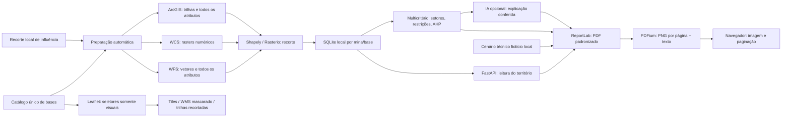

# Arquitetura — território preparado por mina

`executar.py` serve interface compilada/API em `127.0.0.1:8000`. Configuração e limite estadual são lidos em paralelo. Selecionar mina consulta ANM, município, contorno e resumo guardado sem acoplá-los: falha de uma fonte não interrompe as outras.

## Contratos

| Método e rota | Resposta |
|---|---|
| GET /api/saude | Saúde e versão 4.6.1 |
| GET /api/mapa | Uma mina, fundos e catálogo de sete temas/dezoito bases |
| GET /api/mapa/limite-mg | Contorno estadual, fonte/data e aviso de cache quando aplicável |
| GET /api/mapa/trilhas?bbox=... | Trilhas visuais e legenda do enquadramento; 422/503 |
| GET /api/minas/{id}/processo-anm | Atributos cadastrais e fonte, sem geometria; 404/503 |
| GET /api/minas/{id}/limite-municipal | Somente município associado; 404/503 |
| GET /api/minas/{id}/relatorio/previa?versao=hash | Número/texto das páginas de uma versão já aberta; 404/409 |
| GET /api/minas/{id}/relatorio/paginas/{numero}?versao=hash | PNG da página da mesma versão; 404/409 |
| GET /api/minas/{id}/relatorio | PDF GeoVale inline; ?baixar=true entrega attachment; ?pesos= leva os pesos da sugestão; 404/422/503 |
| GET /api/minas/{id}/sugestao/explicacao | Explicação por IA dos setores para os mesmos pesos (?pesos=), com cache; sem chave ou com falha, regras; 404/422/503 |
| GET /api/minas/{id}/sugestao | Setores da área minerada, ranking de usos, restrições, sensibilidade e explicação por regras; ?pesos= com sete valores de 0 a 100; 404/422/503 |
| GET /api/minas/{id}/trilhas-influencia | Trilhas visuais geometricamente recortadas e legenda; 404/503 |
| GET /api/minas/{id}/influencia | Duas Features: influência comum e mina sombreada; 404/503 |
| GET /api/minas/{id}/territorio | Estado/resumo de todas as bases persistidas, independente de visibilidade; 404/503 |
| GET /api/minas/{id}/territorio/{base_id} | Todos os registros/atributos ou metadados matriciais guardados; 404/503 |
| GET /api/minas/{id}/territorio/{base_id}/arquivo | GeoTIFF mascarado já preparado; 404/503 |
| GET / e /assets/... | Interface compilada; raiz retorna 503 se o build faltar |

Rotas desconhecidas retornam 404. O cliente não fornece URL, camada ou polígono arbitrário. IDs de base são derivados da camada do catálogo. Leitura do território não provoca consulta externa. Respostas locais usam no-store; datas são as de preparação da fonte guardada, não o momento de abrir o painel.

## Preparação e armazenamento

`DadosTerritoriais` começa no lifespan FastAPI em uma thread de agendamento, independente dos clientes. Percorre as minas/recortes locais e todas as bases derivadas de CAMADAS. A cada minuto confere bases novas, alteradas, vencidas em 24 h ou falhas com espera de cinco minutos. Usa ThreadPoolExecutor com até três bases simultâneas. Encerrar o servidor para agendamento; resultados completos já gravados permanecem.

`fontes_territorio.py` implementa adaptadores WFS/WCS/ArcGIS. Vetores são validados por esquema/contagem/CRS/IDs e intersectados em Shapely; rasters são lidos/mascarados em Rasterio mantendo grade/valores nativos. Fontes fixas do catálogo, leitura até 32 MiB/25 s por requisição, 2.000 registros/base e 4 milhões de células/raster. [Método completo](DADOS_TERRITORIAIS.md).

SQLite em `.local/territorios.sqlite3`, WAL, uma linha por mina/camada, JSON comprimido e GeoTIFF BLOB. Assinatura inclui definição da base, influência/evidência e versão do método. Gravação da base completa é atômica; falha conserva estado/última resposta válida da mesma assinatura. Mudança do recorte não exibe dados antigos incompatíveis. Arquivos gerados são ignorados pelo Git.

## Interface e mapa

`Influencia.tsx` lê contorno e território ao selecionar. Atualiza o resumo local a cada três segundos enquanto incompleto e a cada minuto quando completo; na falha de leitura, tenta após 15 s. Esses pedidos leem SQLite. Cancela leituras ao trocar/desmarcar mina. O estado completo habilita Ver relatório sem exigir Influência. RelatorioDaMina.tsx busca o PDF e seu hash de versão. PreviaPDF.tsx consulta o manifesto de páginas/textos e exibe PNG da página selecionada. PDFium opera no servidor sob mutex global, com fechamento explícito de documento/página/texto/bitmap. Cache de quatro versões e doze imagens, escala fixa 1,7. Erro de imagem oculta a página e permite repetir. Baixar PDF usa o Blob da versão aberta. Fontes e detalhes ficam no arquivo/documentação, sem painel na tela.

Selecionar pelo cartão ou pela bolinha mostra o contorno da mina, independentemente de Influência. O botão Influência mostra/esconde somente o contorno externo e camadas recortadas e enquadra o recorte por ação explícita, interrompendo transições anteriores. Mina sombreada e influência ficam em pane 430, sem interceptar cliques. O município, pane 420, não altera o enquadramento depois de uma interação da influência ou navegação. Marcador sempre aproxima em zoom 14. Dados persistidos não dependem do estado visual.

Com Influência ativa, `CamadasNaInfluencia.tsx` mostra os seis temas WMS mascarados no navegador pelo polígono irregular, mais trilhas intersectadas no backend. A máscara `clip-path` acompanha coordenadas da camada, zoom/redimensionamento; imagens recortadas ocultam durante animação de zoom. Marcar um tema substitui sua versão recortada pela versão expandida de `MapaTerritorio.tsx`; desmarcar restaura o recorte. Sem Influência os seletores mostram/retiram a versão normal. Ordem, timeout, intensidade e legendas permanecem. Imagens atuais do fornecedor são independentes da data do relatório persistido. Trilhas visuais usam a configuração oficial de cores/nomes, consulta leve por bbox e cache de dez minutos/16 enquadramentos. Contorno estadual tem cache de uma hora, simplificação visual e aviso no reaproveitamento vencido; ANM, dez minutos; município, uma hora. Esses caches de navegação são separados do armazenamento territorial.

As barras ocultam sem desmontar o painel; ResizeObserver atualiza o tamanho Leaflet. Desktop mantém rolagem nas laterais; celular dispõe território, mapa e consulta em sequência. Créditos acompanham as camadas. Um ResizeObserver mede a atribuição Leaflet e atualiza a variável CSS --altura-creditos; legenda territorial e escala ficam acima dela com espaçamento, mesmo com várias linhas. **Sugerir uso** liga o modo sugestão, guardado em `App.tsx`: o mapa recebe uma lista vazia de camadas expandidas e `Influencia.tsx` deixa de montar as camadas recortadas, mas os dois estados continuam guardados e voltam ao sair. `SugestaoNoMapa.tsx` pinta os setores pelo 1º uso em pane próprio, destaca o escolhido e mostra a faixa Modo sugestão / Voltar ao território. `PainelSugestao.tsx` substitui a lista de camadas na barra direita: legenda, setores, ranking com barras, robustez, condicionantes, porquê e pesos. `useSugestao.ts` espera 350 ms depois do último ajuste de peso e recalcula; os mesmos pesos seguem para o relatório. Trocar ou desmarcar a mina encerra o modo e volta aos pesos AHP. Sem autenticação/implantação pública ou chave OpenAI configurada; existe conector opcional no servidor.

## Documento e cenário

`fichas.py` delimita a área minerada pela classe Mineração do MapBiomas guardado e deriva dados objetivos no total, na área minerada e no entorno: em UTM 23S, comprimentos por registro, área da união de polígonos, contagem de pontos e área das células matriciais pelos vértices projetados. Agrupa UCs pelo grupo publicado e confere os pontos de água simulados com a classe do trecho e os limites da CONAMA 357/2005. Não altera geometrias guardadas nem presume volume, pH, profundidade ou biota reais. `mapa_relatorio.py` compõe todos os temas do recorte, mapas individuais, a área minerada, barragens numeradas e os pontos simulados. Reprojeta/reamostra rasters por vizinho mais próximo somente no desenho; cálculos usam a grade nativa.

`multicriterio.py` mede uma vez por coleta, para cada célula de 30 m da área minerada, as sete variáveis, as restrições legais e o setor; guarda em cache e, quando os pesos mudam, refaz só a soma ponderada (cerca de 0,4 s contra 11 s do preparo inicial). Pesos padrão vêm do autovetor da matriz AHP, com razão de consistência calculada. A sensibilidade varia cada peso em ±20%. [Método e porquês](MULTICRITERIO.md).

`comentarios.py` produz a leitura contextual das fichas e a explicação da sugestão, separadas por ID do dado ou do setor. Com chave local, chama o modelo uma vez por ficha (em paralelo, com guia do tema) e uma vez para a sugestão; pede JSON com a lista exata de itens, rejeita números não fornecidos e textos fora do padrão e volta às regras na ficha que falhar. O PDF marca “(IA)” no cabeçalho só quando o texto veio do modelo. Não escolhe uso nem pesos. A configuração de IA é somente de servidor.

O cache do PDF usa dados, cenário, pesos, modelo do documento e configuração do comentarista. O coletor conserva assinatura 4.0.0; API/interface são 4.6.1. `X-Relatorio-Versao` vincula o manifesto/PNGs ao PDF baixável. Versão não guardada: 409 para reabertura; página inexistente: 404. A versão já aberta não mistura páginas de outra emissão.
